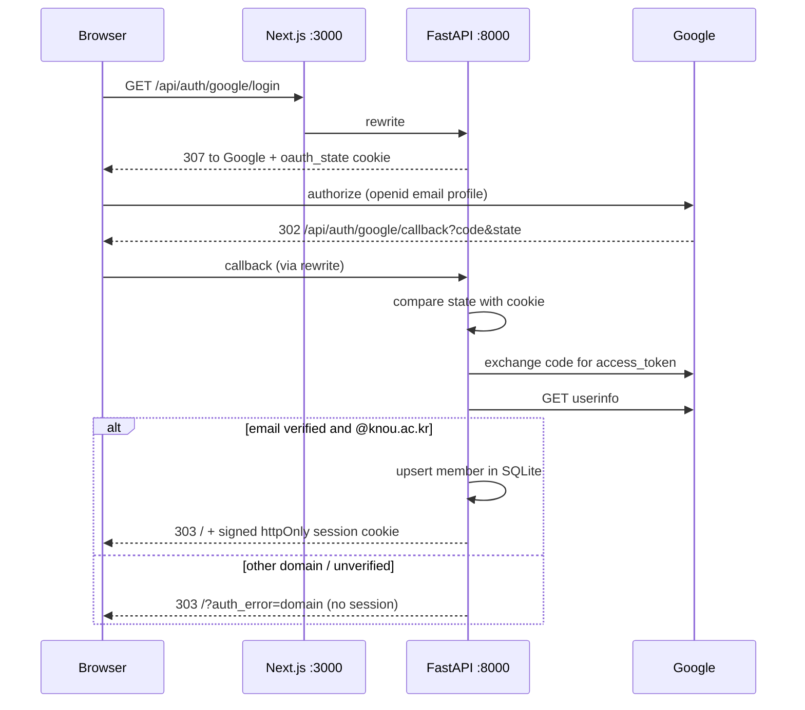

# hackerton-11 — Next.js + FastAPI, Google login restricted to @knou.ac.kr

Next.js frontend with a FastAPI backend. Google sign-in is the entry point, and
only **@knou.ac.kr** addresses become members — enforced on the server, after
the OAuth token exchange.

```
browser ──▶ Next.js :3000 ──(rewrite /api/*)──▶ FastAPI :8000
                │                                     │
                └──────── Google OAuth ──────────────┘
```

The Next.js rewrite proxies `/api/*` to FastAPI, so the browser only ever talks
to one origin: no CORS setup, no API base URL in the client bundle.

## Requirements

- Node.js 20+ and pnpm
- Python 3.12+ and [uv](https://docs.astral.sh/uv/)

## Run

```bash
cd backend
cp .env.example .env     # fill in the Google pair + SESSION_SECRET
uv sync
uv run uvicorn app.main:app --reload --port 8000

# separate terminal
cd frontend
pnpm install
pnpm dev                 # http://localhost:3000
```

Or from the repo root: `make setup` once, then `make dev` (Ctrl-C stops both).

If `/api/*` returns **500**, the FastAPI process is not running — the Next.js
proxy has nothing to forward to. `make doctor` reports which side is down and
whether Google credentials are loaded:

```
backend  :8000 ok
frontend :3000 ok
database : .../backend/app.db
google   : MISSING (logins redirect to ?auth_error=config)
```


## Google OAuth setup

1. Google Cloud Console → **APIs & Services → Credentials → Create OAuth client
   ID → Web application**.
2. Add an authorized redirect URI that matches `OAUTH_REDIRECT_URI` exactly:
   `http://localhost:3000/api/auth/google/callback` (production: your HTTPS
   origin, same path).
3. Paste the client ID/secret into `backend/.env`.

No extra scopes or app verification are needed for `openid email profile`
outside an organization-only project; the domain restriction is implemented by
this app, not by Google.

## Configuration

`backend/.env` (all optional except the Google pair):

| Variable | Default | Purpose |
| --- | --- | --- |
| `GOOGLE_CLIENT_ID` / `GOOGLE_CLIENT_SECRET` | — | OAuth client. Login returns 503 without them. |
| `OAUTH_REDIRECT_URI` | `http://localhost:3000/api/auth/google/callback` | Must match Google Console exactly |
| `SESSION_SECRET` | random per process | HMAC key for the session cookie. **Set it in production**, or every restart logs everyone out |
| `SESSION_TTL` | `604800` (7 days) | Session lifetime in seconds |
| `ALLOWED_EMAIL_DOMAIN` | `knou.ac.kr` | The only domain that can become a member |
| `COOKIE_SECURE` | `0` | Set `1` behind HTTPS |
| `DATABASE_PATH` | `backend/app.db` | SQLite file. Relative paths resolve against `backend/`, not the CWD |
| `GOOGLE_AUTHORIZE_URL` / `GOOGLE_TOKEN_URL` / `GOOGLE_USERINFO_URL` | Google's endpoints | Overridable to exercise the flow against a fake IdP |

Frontend reads `BACKEND_URL` (default `http://127.0.0.1:8000`) for the proxy.

## Auth flow



Membership is decided **only** by the server: the domain check happens after
the code exchange, compares the whole `@domain` suffix, and requires
`email_verified`. A client cannot promote itself by editing a request.

## Data storage

Everything a member saves lives in SQLite (`DATABASE_PATH`, default
`backend/app.db`). The file is created on startup and upgraded in place by
`MIGRATIONS` in `app/db.py` — an existing database is never recreated, and a
database written by an older build is adopted rather than rejected.

- WAL journal mode, `foreign_keys=ON`
- deleting a member cascades to their entries
- every query is scoped by `user_id`, so one member can never read or delete
  another's rows
- `GET /api/stats` returns row counts (login required) if you want to confirm
  from the UI that something actually persisted

To start over: stop the server and delete `backend/app.db*`.

## API

| Method | Path | Description |
| --- | --- | --- |
| `GET` | `/api/health` | Liveness |
| `GET` | `/api/stats` | Row counts for the logged-in member |
| `GET` | `/api/entries` | List own entries, newest first |
| `POST` | `/api/entries` | Create `{title, content}` → `201` |
| `GET` | `/api/entries/{id}` | Read one |
| `PUT` | `/api/entries/{id}` | Update `{title, content}` |
| `DELETE` | `/api/entries/{id}` | Delete → `204` |
| `GET` | `/api/studies` | Study list, newest first (public) |
| `POST` | `/api/studies` | Create `{title, description, capacity}` → `201`, owner auto-joins |
| `GET` | `/api/studies/{id}` | Study detail + members; `is_member`/`is_owner` if logged in |
| `POST` | `/api/studies/{id}/join` | Join → `200`; `409` when already joined or full |
| `DELETE` | `/api/studies/{id}/members/me` | Leave → `200`; owner gets `403` |
| `GET` / `PUT` | `/api/semester` | Semester period `{start_date, end_date}` |
| `GET` / `POST` | `/api/courses` | Courses `{name, credits, total_lectures, done_lectures, minutes_per_lecture}` |
| `PUT` / `DELETE` | `/api/courses/{id}` | Update / delete (cascades to its deadlines and blocks) |
| `GET` / `POST` | `/api/deadlines` | Deadlines `{course_id, kind: assignment\|attendance\|exam, title, due_date}` |
| `DELETE` | `/api/deadlines/{id}` | Delete |
| `GET` / `PUT` | `/api/availability` | Weekly free time `{slots: [{weekday 0=Mon, start_time, end_time}]}`, replaced as a whole |
| `GET` | `/api/plan?start=&end=` | Timetable blocks in a date range (both optional) |
| `POST` | `/api/plan/generate` | Re-plan from `{today, now}`; finished and past blocks are kept |
| `PATCH` | `/api/plan/blocks/{id}` | `{done}` check-off |
| `GET` | `/api/auth/google/login` | Redirect to Google (sets `oauth_state`) |
| `GET` | `/api/auth/google/callback` | Code exchange, domain check, session issue |
| `GET` | `/api/auth/session` | `{user: … \| null}` — never 401s |
| `GET` | `/api/auth/me` | Current member, `401` when anonymous |
| `POST` | `/api/auth/logout` | Clears the session cookie |

Protect your own routes by depending on `app.deps.current_user`.

## Semester planner

`app/services/planner.py` turns what is left into dated blocks, with no I/O:

- one task per remaining lecture (due a week before the course's exam, or the
  semester end), 3 × 60 min per assignment, 1 × 60 min per attendance class,
  and 2 × 60 min per credit of exam review in the two weeks before the exam
- tasks fill the weekly free time earliest-deadline-first, skipping time
  already used by kept blocks and, for today, time that has passed
- the same course is not stacked back-to-back when another course's task is
  due within a week of it
- anything that cannot fit before its deadline is returned as `unscheduled`
  and shown in the UI, never placed late

Checked-off lecture blocks count toward a course's progress, so re-planning
never schedules a lecture twice.

## Layout

```
backend/
  app/main.py            app, lifespan DB init
  app/config.py          env settings, .env loading
  app/security.py        HMAC-signed session cookie (stdlib only)
  app/db.py              SQLite schema migrations + members/entries queries
  app/deps.py            current_user dependency
  app/api/auth.py        OAuth endpoints
  app/api/entries.py     growth-log CRUD, scoped to the logged-in member
  app/api/studies.py     study create/list/detail/join/leave
  app/services/google.py token exchange + userinfo
  tests/test_auth.py     auth contract tests, Google mocked
  tests/test_studies.py  study lifecycle, capacity, concurrency, auth
frontend/
  next.config.ts         /api/* → FastAPI rewrite
  src/lib/api.ts         session + entry client helpers
  src/components/auth-bar.tsx   login button, member card, error states
  src/components/entry-log.tsx  create/edit/delete saved entries
  src/components/dashboard.tsx  session owner for the page
  src/app/page.tsx       page shell
Makefile                 setup / dev / test / build / clean
```

## Testing login without Google credentials

`scripts/fake_idp.py` is a local stand-in for Google's OAuth endpoints, so the
whole flow (state cookie, code exchange, domain check, session) can be driven
in a browser:

```bash
make fake-idp   # :8099
GOOGLE_CLIENT_ID=fake-client GOOGLE_CLIENT_SECRET=fake-secret \
GOOGLE_AUTHORIZE_URL=http://127.0.0.1:8099/authorize \
GOOGLE_TOKEN_URL=http://127.0.0.1:8099/token \
GOOGLE_USERINFO_URL=http://127.0.0.1:8099/userinfo \
uv run uvicorn app.main:app --reload --port 8000
```

Then `curl 'http://127.0.0.1:8099/scenario?code=code-outsider'` switches the
next login to a rejected scenario (`code-member`, `code-case`, `code-outsider`,
`code-spoof`, `code-unverified`).

## Test

```bash
cd backend && uv run pytest
cd frontend && pnpm lint && pnpm build
```
